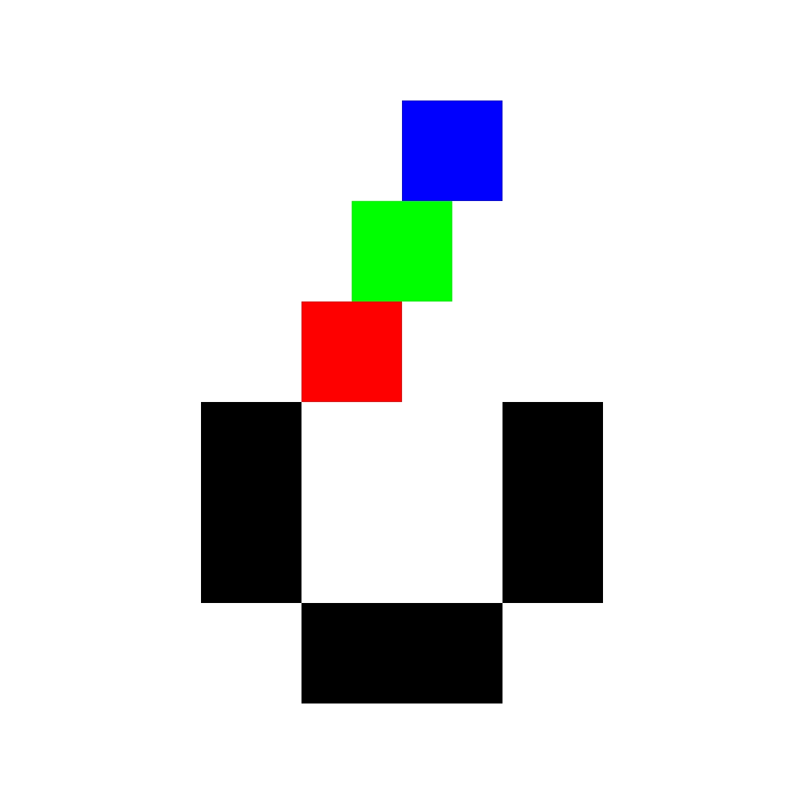

<p align="center">
	
</p>

# Múnka

Múnka is a cross-platform time tracking app built with Flutter. It helps users track work sessions, organize entries by project and profile, and keep time records stored locally.


[](https://www.gnu.org/licenses/gpl-3.0)

## Project Scope

The project focuses on providing a simple, private, and customizable time tracking experience:

- Start and stop work timers
- Record projects and notes
- Create and edit time entries manually
- Review recent entries
- View statistics across different time ranges and projects
- Export tracked data to CSV
- Organize tracking with multiple profiles
- Keep work data available locally

## App Features

### Time tracking

- Start and stop a live timer
- Display elapsed tracking time
- Add project names and notes when completing a session
- Clear an active session without saving it
- Persist active and completed entries

### Time entries

- Create entries with custom start and end times
- Add project names and notes
- Edit existing entries
- Review recent completed entries
- Open entries from the dedicated entries list

### Profiles

- Create and edit profiles
- Choose a default profile
- Switch between profiles instantly
- Associate time entries with profiles
- Remove profiles and their entries

### Statistics and export

- View time tracking statistics by day, week, month, and year
- Break down tracked time by project
- Explore trends through clear charts
- Export time entry data to CSV for external analysis

### Preferences

- Light, dark, and system theme modes
- English and Hungarian localization
- Application version information

### Cross-platform support

- Android
- iOS
- macOS
- Web
- Windows

The app uses platform directories and shared Flutter code to provide a consistent experience across supported targets.

## Getting Started

1. Install Flutter (stable) and verify your setup:

```bash
flutter doctor
```

2. Get dependencies:

```bash
flutter pub get
```

3. Generate localization and model files:

```bash
flutter gen-l10n
dart run build_runner build --delete-conflicting-outputs
```

4. Run the app with local, persistent providers:

```bash
flutter run --target lib/main.dart
```

5. Run the app with development providers and example data:

```bash
flutter run --target lib/main_dev.dart
```

## Developer Commands

- `flutter pub get` - Get dependencies
- `dart run build_runner build --delete-conflicting-outputs` - Generate Freezed, JSON serialization, and Drift code
- `flutter gen-l10n` - Generate localization files
- `dart format --set-exit-if-changed .` - Check formatting
- `flutter analyze --no-pub` - Analyze the code for potential issues
- `flutter test` - Run the test suite

## Contribution Opportunities

Want to contribute? Open an issue using one of the available templates:

- Report a bug: [Bug report template](https://github.com/csertant/munka/issues/new?template=bug_report.yml)
- Suggest an improvement: [Feature request template](https://github.com/csertant/munka/issues/new?template=feature_request.yml)
- Browse all options: [Open issue templates](https://github.com/csertant/munka/issues/new/choose)

Before opening a new issue, please search existing issues to avoid duplicates.

## Contact

For direct contact, email:

- nosebitestudios@gmail.com
